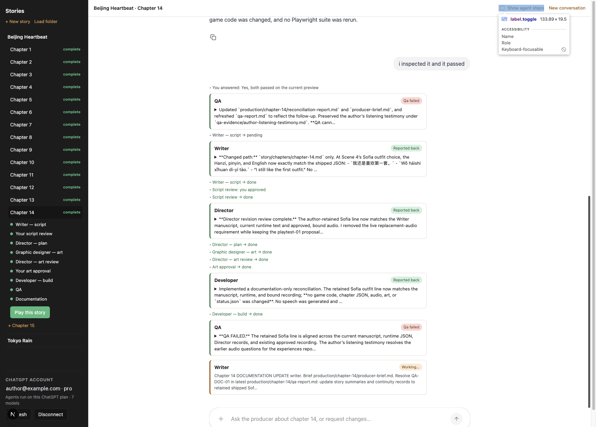

# Virtual Novel Builder

A studio of AI agents that produces visual-novel chapters, modeled on the Beijing Heartbeat workflow.



- **backend/** — LangGraph server. `novel_builder/producer.py` is a deepagents agent (the Producer) that delegates to
  specialist subagents in `novel_builder/agents/` (writer, director, graphic_designer, developer, qa) and pauses for
  author approval (script, art) via `interrupt()`.
- **web/** — Next.js + CopilotKit chat with a pipeline board and approval cards.
- **templates/vn-starter/** — React + Phaser game every new project starts from (rebuild with `scripts/build_template.sh`).
- **projects/<user>/<novel>/** — generated workspaces (gitignored).

## Run

```bash
cd backend && uv sync && uv run langgraph dev --port 2024
```

```bash
cd web && npm install && npm run dev
```

Open http://localhost:3000 and describe the novel and chapter.

**Model access.** Click **Connect ChatGPT** on the board and enter the one-time code at OpenAI's device page. While
connected, every agent and image call runs on your ChatGPT plan through the Codex backend
(`https://chatgpt.com/backend-api/codex/responses`, device-code OAuth with Codex's public client id, same approach as
Aubrey in SaaS Agent). Tokens are Fernet-encrypted in `.data/credentials/` (set `NB_CREDENTIAL_KEY` to a Fernet key in
production; locally one is generated in `.data/credential.key`). Not connected → the server's `OPENAI_API_KEY` is used.
This path relies on an undocumented ChatGPT backend that OpenAI may change. Speech uses MiniMax (`MINIMAX_API_KEY`).

## Change an agent

Each specialist is a deepagents `SubAgent` in `backend/novel_builder/agents/<name>.py` (prompt, model, tools).
Add a specialist by adding a module there and listing it in `producer.py`.

## SaaS seams

- Per-user workspace: `make_graph(config)` is a per-run graph factory; `workspace.get_backend(owner)` returns the backend.
- Shell/files: swap `LocalShellBackend` for a sandbox backend.
- Secrets: `settings.get_key`; ChatGPT tokens: `codex_oauth` (swap the encrypted file store for a DB table).
- Threads: the LangGraph server's checkpointer.
- Users: CopilotKit `identifyUser` → `user_id`.

## Checks

```bash
cd backend && uv run python test_tools.py
```
